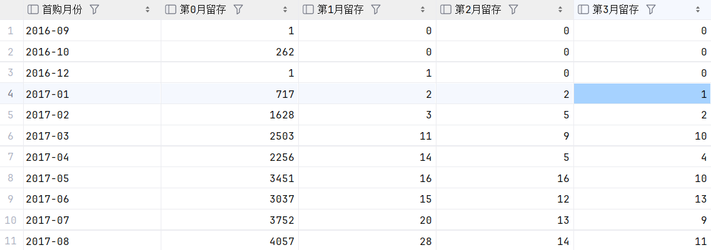

# Olist 电商数据分析：留存矩阵与用户价值分层

基于 Olist 巴西电商公开数据集（9.9 万订单 / 9.3 万客户），用原生 SQL 完成 **GMV 口径核算、用户月度留存矩阵（Cohort）、RFM 价值分层**，并由 Python 一键导出多 Sheet Excel 报表。

**技术栈**：SQLite · SQL（CTE / 窗口函数 / NTILE）· Python · pandas · openpyxl

---

## 结论先行

| 指标 | 结果 | 说明 |
|---|---|---|
| GMV（已妥投） | **1,584 万 BRL** | 商品金额 + 运费；与支付表对账差异 1.2% |
| 单笔订单均价 | **159.8 BRL** | 按含商品明细的已妥投订单计算 |
| 客户数 | **93,358** | 按 `customer_unique_id` 去重（`customer_id` 是订单级 ID） |
| 复购率 | **3.0%** | 仅 2,801 人购买 ≥ 2 次 |
| 次月留存率 | **0.2% – 0.7%** | 15 个首购批次，无一批次超过 1% |

**三条业务判断**

1. **这是一个拉新驱动、留存趋近于零的平台。** 97.0% 的用户只购买一次，次月留存率长期在 1% 以下且不随批次改善——问题不在某个月的活动，而在"首购即终点"的产品结构。
2. **因此 RFM 的 F（频次）维度不能用 NTILE 分档。** 97% 的用户频次都是 1，NTILE(5) 会把几乎所有用户压进同一档，F 分失去区分度；本项目改用业务阈值（1 次→1 分、2 次→3 分、≥3 次→5 分）。
3. **运营重点应是"首购后的二次触达"，而不是维系老客。** 客群结构中"重要发展客户"占 34.7%（近期购买、金额高、但只买过一次），是唯一有拉动空间的群体；"重要挽留客户"占 22.5%（平均 394 天未回购、人均消费 238.9 BRL），属于已流失的高价值人群。

---

## 数据

Olist Brazilian E-Commerce Public Dataset（Kaggle，2016-09 ~ 2018-08）：
https://www.kaggle.com/datasets/olistbr/brazilian-ecommerce

| 表 | 行数 | 用途 |
|---|---|---|
| `orders` | 99,441 | 订单主表，含状态与 5 个时间戳 |
| `order_items` | 112,650 | 订单明细，金额以"分"存整数 |
| `customers` | 99,441 | 客户维度，含 `customer_unique_id` |
| `payments` | 103,886 | 支付流水（本期未使用，见"局限"） |
| `products` | 32,951 | 商品维度，73 个品类，610 条品类缺失 |
| `sellers` | 3,095 | 卖家维度 |

已妥投订单 96,478 笔（占 97.0%），其余 2,963 笔为取消/处理中，分析时全部剔除。

> 原始 CSV 体积约 130 MB，不纳入 Git；`olist.db` 与导出报表同样被 `.gitignore` 排除。

---

## 分析框架

```
data/*.csv ──▶ import_data.py ──▶ olist.db（6 张表 + 主外键）
                                      │
                          queries.sql │ 原生 SQL
                                      ▼
               ┌──────────────┬──────────────┬──────────────┐
               │  GMV 与对账   │  留存矩阵     │  RFM 分层     │
               └──────────────┴──────────────┴──────────────┘
                                      │
                          generate_report.py
                                      ▼
                          电商分析报表.xlsx（多 Sheet）
```

---

## 核心分析一：GMV 口径与对账

口径定义：`sum(price) + sum(freight_value)`，仅 `order_status = 'delivered'`，金额从分换算为 BRL。

```sql
select (sum(i.price) + sum(i.freight_value)) / 100.0            as GMV,
       sum(i.freight_value) / 100.0                             as 运费,
       count(distinct o.order_id)                               as 真实订单数
       (sum(i.price)+sum(i.freight_value))/COUNT(DISTINCT o.order_id)/100.0 as 客单价 
from orders o
join order_items i on i.order_id = o.order_id
where o.order_status = 'delivered';
```

**对账**：按 `order_id` 聚合后，商品明细合计 15,843,409.78 BRL，支付流水合计 15,422,461.77 BRL,对账率1.2%，说明近期免邮策略或分期手续费补贴正常。差额（约 42 万）主要源于未支付运费、分期手续费及退款。

> 注意：`sum(price)` 直接 join 会因一单多明细而行放大，金额列不受影响，但 `count(order_id)` 必须用 `count(distinct)`。

---

## 核心分析二：用户月度留存矩阵（Cohort）

**三步 CTE**：

1. 把订单对齐到"用户 × 月份"，用 `年 * 12 + 月` 转成连续的月份序号（避免跨年时 `月` 字段回绕）；
2. 每个用户取 `min(月份序号)` 作为首购月；
3. 当前月序号减首购序号得到"购买后第几个月"，再按首购月分组透视。

关键改进：**分母是各批次的首购人数，输出留存率而不是留存人数**——只给人数无法比较不同规模的批次。

```sql
with o as (
    select distinct c.customer_unique_id as uid,
           cast(strftime('%Y', o.order_purchase_timestamp) as integer) * 12
         + cast(strftime('%m', o.order_purchase_timestamp) as integer) as m
    from orders o join customers c on c.customer_id = o.customer_id
    where o.order_status = 'delivered'
),
f as (select uid, min(m) as first_m from o group by uid),
c as (select o.uid, f.first_m, o.m - f.first_m as d from o join f on f.uid = o.uid)
select printf('%04d-%02d', (first_m - 1) / 12, (first_m - 1) % 12 + 1) as 首购月,
       count(distinct uid)                                              as 首购人数,
       round(100.0 * count(distinct case when d = 1 then uid end) / count(distinct uid), 2) as 次月留存率
from c
group by first_m
order by first_m;
```

**结果**：2017-01 至 2018-03 的 20 个批次，次月留存率 0.18% – 0.72%，没有上升趋势。留存曲线更像"一次性交易"而非"漏桶"。


> 图：

---

## 核心分析三：RFM 用户价值分层

| 维度 | 含义 | 分档方式 | 理由 |
|---|---|---|---|
| R | 距最后一次购买的天数 | `NTILE(5) OVER (ORDER BY 最近消费天数 DESC)` | 分布连续，等频分档有效 |
| F | 已妥投订单数 | 业务阈值：1→1 分、2→3 分、≥3→5 分 | 97% 用户频次为 1，等频分档失效 |
| M | 累计消费金额（含运费） | `NTILE(5) OVER (ORDER BY 消费金额 ASC)` | 分布右偏严重，等频分档可压住长尾 |

**8 类客群结果**

| 客群 | 人数 | 占比 | 人均消费 (BRL) | 平均 R（天） |
|---|---:|---:|---:|---:|
| 重要发展客户 | 32,404 | 34.71% | 231.33 | 133 |
| 一般发展客户 | 21,796 | 23.35% | 54.53 | 134 |
| 重要挽留客户 | 20,992 | 22.49% | 238.90 | 394 |
| 一般挽留客户 | 15,365 | 16.46% | 55.71 | 395 |
| 重要价值客户 | 1,713 | 1.83% | 332.37 | 132 |
| 重要保持客户 | 905 | 0.97% | 311.73 | 379 |
| 一般价值客户 | 101 | 0.11% | 69.41 | 119 |
| 一般保持客户 | 82 | 0.09% | 69.66 | 412 |

**解读**：真正意义上的"重要价值客户"（R/F/M 均高）只有 1.83%，因为 F ≥ 3 的门槛在复购率仅 3% 的数据里天然稀缺。对业务而言，更有价值的信号是"重要发展客户"——他们最近买过、客单价不低（231 BRL），但只买一次；这是首购后 30 天内二次触达的唯一抓手。

---

## 口径与假设

- 只分析 `order_status = 'delivered'` 的订单，其余状态视为未成交；
- 金额在入库时统一转为**整数分**存储（`round(price * 100)`），查询时 `/100.0` 还原，避免浮点累积误差；
- 用户身份以 `customer_unique_id` 为准，`customer_id` 与订单一一对应，不能用于用户级聚合；
- RFM 的 R 以数据集最大购买日为"快照日"，不是真实当前日期，因此 R 是相对值；
- 留存矩阵的分母是首购人数，不是当月活跃人数。

---

## 项目结构

```text
sql_olist/
├── data/                  # 9 个原始 CSV（不入库）
├── img/                   # README 用图：留存热力图、客群分布
├── import_data.py         # 建表（主外键 + 类型）+ 导入 CSV
├── queries.sql            # 核心 SQL：GMV / 留存矩阵 / RFM
├── generate_report.py     # 执行 SQL 并导出多 Sheet Excel
├── requirements.txt
└── README.md
```

## 快速开始

```bash
pip install -r requirements.txt
# 将 9 个 CSV 放入 data/
python import_data.py       # 建表 + 导入 → olist.db
python generate_report.py   # → 电商分析报表.xlsx
```
